# 💼 Naukri Job Market Analysis & Salary Prediction

<p align="center">

[](https://www.python.org/)
[](https://pandas.pydata.org/)
[](https://scikit-learn.org/)
[](https://xgboost.readthedocs.io/)
[](https://powerbi.microsoft.com/)
[](LICENSE)
[](#)

</p>

An end-to-end **Data Science & Machine Learning Capstone Project** analyzing India's data science, analytics, and AI employment landscape. The project integrates **Automated Web Scraping**, **Data Engineering & Preprocessing**, **Exploratory Data Analysis (EDA)**, **Multi-Class Machine Learning Classification**, **Salary Regression Modeling**, and an interactive **Power BI Intelligence Dashboard**.

---

## 📑 Table of Contents

- [Executive Overview](#-executive-overview)
- [End-to-End Workflow Architecture](#-end-to-end-workflow-architecture)
- [Repository Structure](#-repository-structure)
- [Dataset & Data Engineering](#-dataset--data-engineering)
- [Exploratory Data Analysis & Visual Insights](#-exploratory-data-analysis--visual-insights)
- [Machine Learning & Benchmarks](#-machine-learning--benchmarks)
- [Power BI Intelligence Dashboard](#-power-bi-intelligence-dashboard)
- [CLI Inference Engine & Demo](#-cli-inference-engine--demo)
- [Installation & How to Run](#-installation--how-to-run)
- [Key Strategic Takeaways](#-key-strategic-takeaways)
- [Walkthrough Videos](#-walkthrough-videos)
- [Author & Acknowledgements](#-author--acknowledgements)

---

## 📖 Executive Overview

Understanding industry hiring requirements, salary distributions, and required tech stacks is crucial for job seekers, recruiters, and engineering leaders. This project collects and analyzes **4,136 live job listings** scraped from **Naukri.com** across six primary data disciplines:
1. **Data Scientist**
2. **Machine Learning Engineer**
3. **Data Analyst**
4. **Data Engineer**
5. **Business Analyst**
6. **AI Engineer**

### Core Project Capabilities:
- 🌐 **Automated Scraping**: Headless Selenium + BeautifulSoup pipeline extracting rich attributes (skills, experience, compensation, location, rating, reviews).
- 🧹 **Robust Feature Engineering**: Standardized text tokens, parsed experience/salary spans into numeric LPA metrics, and derived experience tiers.
- 📊 **Statistical Analysis & Visualization**: 13 comprehensive EDA distributions uncovering market concentration and skill demand.
- 🤖 **Machine Learning Models**:
  - **Job Role Multi-Class Classifier**: XGBoost model achieving **65.2% Test Accuracy** and **67.1% 5-Fold Cross-Validation Accuracy** via combined TF-IDF skill embeddings and tabular metadata.
  - **Salary Estimation Regressor**: Baseline model predicting compensation in LPA for disclosed listings ($R^2 \approx 0.41$).
- 📈 **Interactive Power BI Dashboard**: Complete `.pbix` report with KPI cards, multi-dimensional slicers, and AI-powered **Key Influencers** visual.
- 💻 **Production Inference CLI**: Interactive command-line tool (`src/predict.py`) for instantaneous role fit classification and salary range estimation.

---

## 🔄 End-to-End Workflow Architecture

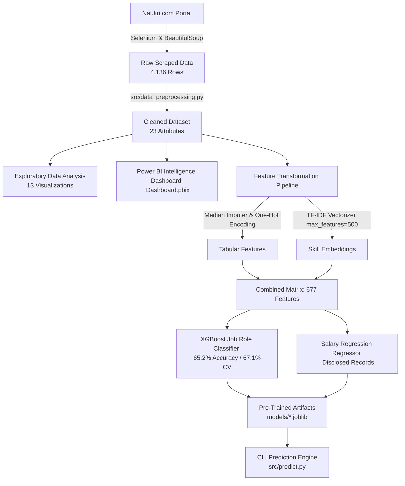

---

## 📂 Repository Structure

```text
Naukri-Job-Market-Analysis-and-Salary-Prediction/
│
├── dashboard/
│   └── Dashboard.pbix                   # Interactive Microsoft Power BI Report
│
├── dataset/
│   ├── naukri_jobs.csv                  # Raw scraped dataset (4,136 records)
│   └── cleaned_naukri_jobs.csv          # Feature-engineered dataset (23 attributes)
│
├── docs/
│   ├── DATA_DICTIONARY.md               # Schema definitions, missing value breakdown
│   ├── EXECUTIVE_SUMMARY.md             # Strategic business insights & takeaways
│   ├── MODEL_PERFORMANCE.md             # Benchmark tables, confusion matrix & metrics
│   └── POWERBI_DASHBOARD_GUIDE.md       # Visual architecture, KPIs & DAX measures
│
├── models/
│   ├── role_classifier_bundle.joblib    # Pre-trained XGBoost model + pipelines
│   └── salary_predictor_bundle.joblib   # Pre-trained Salary Regressor + pipelines
│
├── notebooks/
│   ├── 01_scraping.ipynb                # Web scraping pipeline
│   ├── 02_cleaning.ipynb                # Data cleaning & feature engineering
│   ├── 03_EDA.ipynb                     # Exploratory Data Analysis & visual charts
│   └── 04_Model.ipynb                   # ML benchmark, training & evaluation
│
├── screenshots/                         # Visualization & dashboard figures (01 to 16)
│   ├── 01_job_distribution_by_role.png
│   ├── 02_top_hiring_companies.png
│   ├── 03_top_hiring_locations.png
│   ├── 04_average_experience_distribution.png
│   ├── 05_experience_level_distribution.png
│   ├── 06_top_demanded_skills.png
│   ├── 07_top_skills_across_job_roles.png
│   ├── 08_company_rating_distribution.png
│   ├── 09_company_reviews_distribution.png
│   ├── 10_company_rating_vs_reviews.png
│   ├── 11_salary_vs_experience.png
│   ├── 12_feature_correlation_heatmap.png
│   ├── 13_jobs_by_posting_age.png
│   ├── 14_model_accuracy_comparison.png
│   ├── 15_powerbi_dashboard.png
│   └── 16_prediction_demo.png
│
├── src/
│   ├── __init__.py                      # Package descriptor
│   ├── data_preprocessing.py            # Modular cleaning & feature engineering
│   ├── train_role_classifier.py         # Multi-class ML model training & evaluation
│   ├── train_salary_predictor.py        # Salary regression model training
│   └── predict.py                       # CLI inference engine for live predictions
│
├── .gitignore                           # Python & Jupyter ignore configurations
├── LICENSE                              # MIT License
├── README.md                            # Main project documentation
└── requirements.txt                     # Pinned project dependencies
```

---

## 📊 Dataset & Data Engineering

The dataset comprises **4,136 job postings** collected directly from Naukri.com across India's primary tech hubs.

### Feature Summary
- **Original Attributes (12)**: `Role Searched`, `Job Title`, `Company`, `Rating`, `Reviews`, `Experience`, `Salary`, `Location`, `Description`, `Skills`, `Posted`, `Job Link`.
- **Derived / Engineered Attributes (11)**: `Min Experience`, `Max Experience`, `Average Experience`, `Min Salary`, `Max Salary`, `Average Salary`, `Posted Days`, `Experience Level`, `Salary Category`, `Skill Count`, `Primary Location`.

### Data Quality & Compensation Reality Note
In Indian tech recruiting, **88.8% of postings state "Not Disclosed"** for salary. Rather than injecting synthetic bias through arbitrary imputation:
1. Ground truth job roles are **100% complete**, serving as the foundation for our multi-class XGBoost classifier.
2. Verified salary data ($N = 463$) was utilized for specialized correlation studies, compensation band analysis, and regression modeling.
3. For comprehensive details, see the [Data Dictionary](docs/DATA_DICTIONARY.md).

---

## 📈 Exploratory Data Analysis & Visual Insights

### 1. Job Distribution by Role
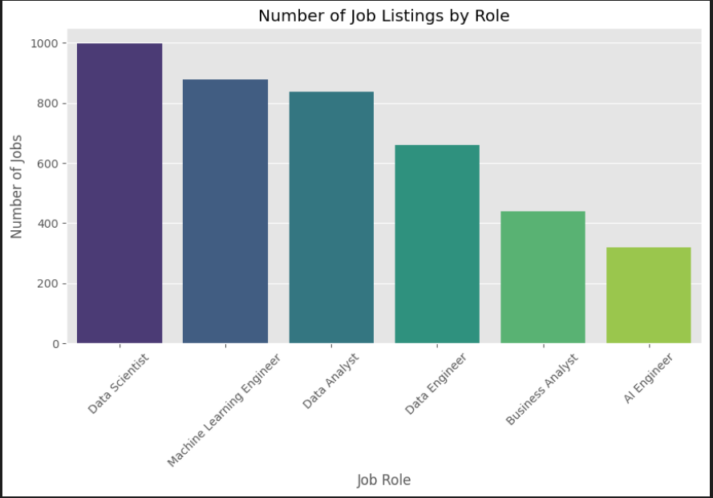

> **Key Insight**: **Data Scientist** represents the highest volume of postings (~1,000), followed closely by **Machine Learning Engineer** (~850) and **Data Analyst** (~800), demonstrating robust enterprise demand for advanced analytics and modeling talent.

---

### 2. Top Hiring Companies
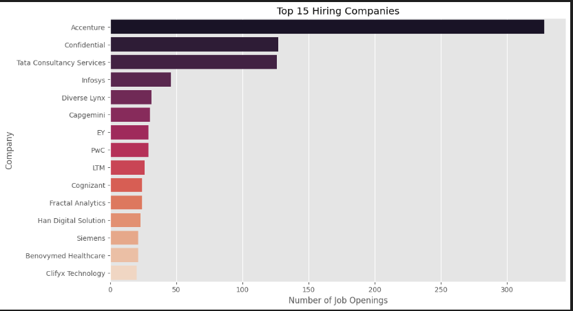

> **Key Insight**: Major IT consulting leaders dominate recruitment volume, with **Accenture** leading at over 330 postings, alongside **TCS**, **Infosys**, and confidential staffing agencies.

---

### 3. Top Hiring Locations
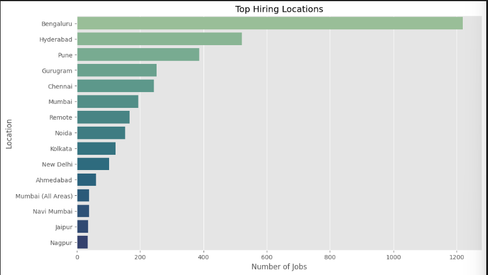

> **Key Insight**: **Bengaluru** is India's preeminent analytics capital (>1,100 listings), commanding over **26% market share**, followed by **Hyderabad**, **Pune**, and **Gurugram**.

---

### 4. Experience Requirements Distribution
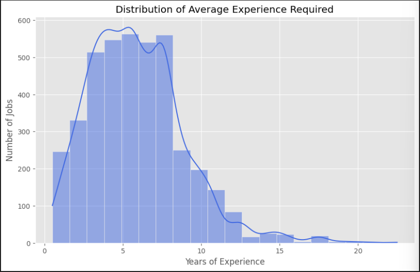

> **Key Insight**: The average experience requirement is **5.90 years**, with a strong density around the **3 to 8 years** band, highlighting employer preference for mid-level autonomous contributors.

---

### 5. Experience Level Categorization
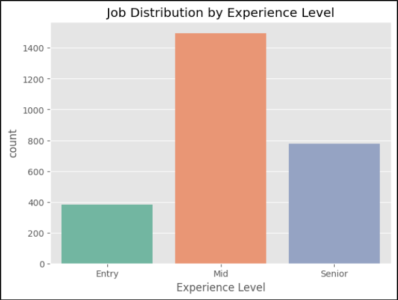

> **Key Insight**: **Junior (3–5 Yrs)** and **Mid-Level (6–8 Yrs)** roles together comprise nearly **70%** of all market opportunities.

---

### 6. Most Demanded Technical Skills
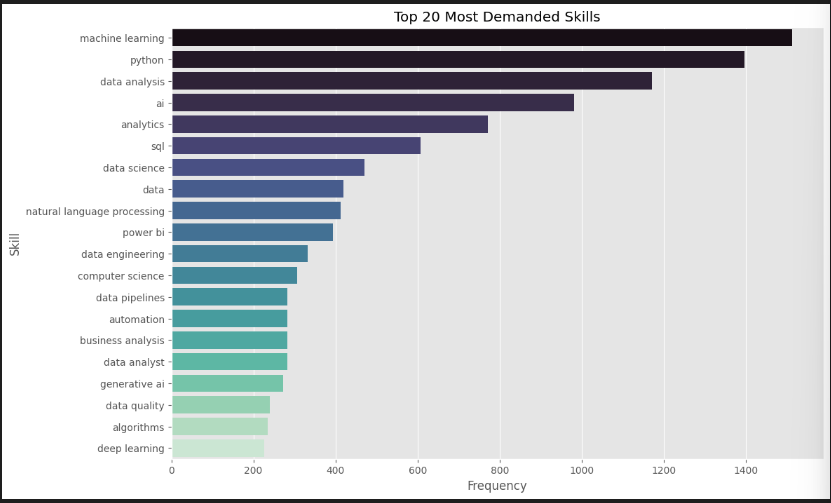

> **Key Insight**: **Python**, **SQL**, and **Machine Learning** constitute the core technical foundation requested in over 70% of tech job listings.

---

### 7. Skill Demand Across Job Roles
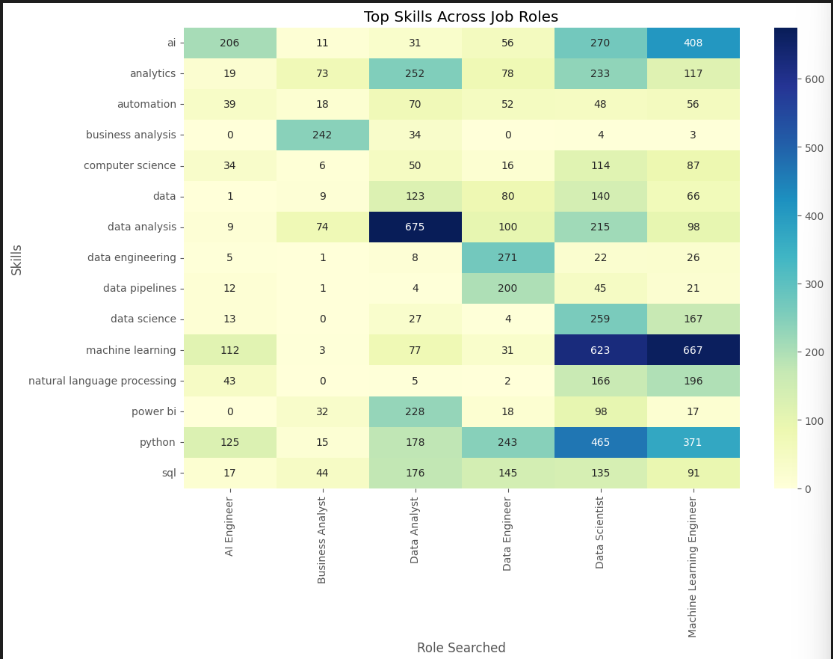

> **Key Insight**: Distinct role clusters emerge: `Data Analyst` prioritizes **SQL, Power BI, Excel**; `Data Engineer` prioritizes **Spark, Python, AWS, ETL**; while `Data Scientist` & `ML Engineer` require **Python, ML, Deep Learning, NLP**.

---

### 8. Company Rating Distribution
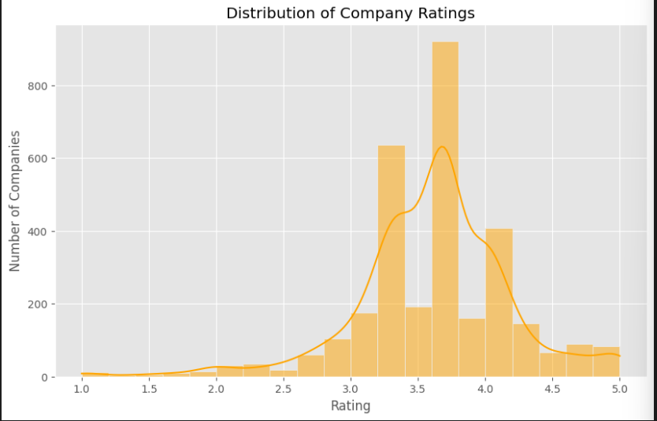

> **Key Insight**: Most hiring organizations maintain ratings concentrated between **3.5 and 4.2**, reflecting positive overall employee sentiment.

---

### 9. Company Reviews Distribution
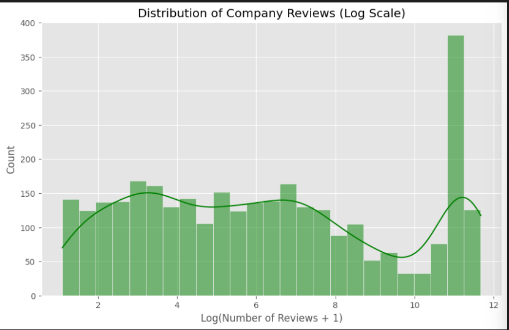

> **Key Insight**: Large IT services corporations have review counts exceeding 10,000+, while specialized startups and mid-market firms maintain smaller footprints (<500 reviews).

---

### 10. Company Rating vs. Reviews
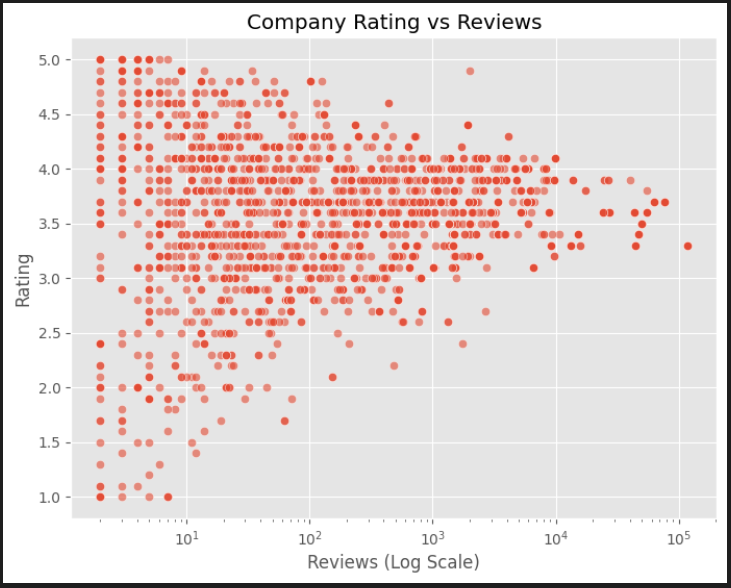

> **Key Insight**: Review volume does not correlate with higher ratings ($r \approx 0.05$), proving employee satisfaction is independent of company size.

---

### 11. Salary vs. Experience
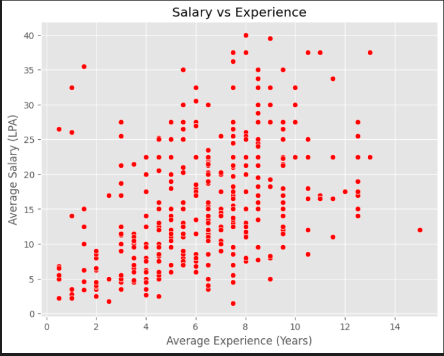

> **Key Insight**: Compensation displays a strong positive relationship with experience ($r = 0.58$), scaling from **3–7 LPA** for junior engineers to **25–45+ LPA** for senior architects.

---

### 12. Feature Correlation Heatmap
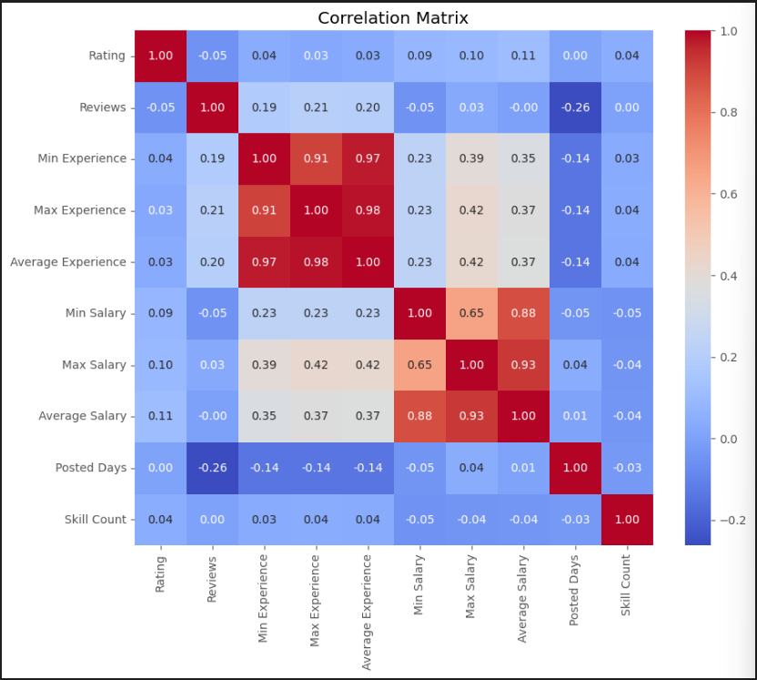

> **Key Insight**: Minimum and maximum experience correlate strongly with salary, while company ratings and posting age exhibit low correlation with compensation.

---

### 13. Hiring Activity by Posting Age
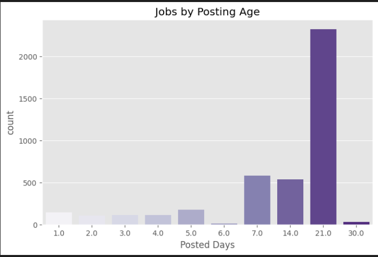

> **Key Insight**: Job postings hit peak recruitment activity around **20 to 21 days**, reflecting a 3 to 4-week active screening cycle.

---

## 🤖 Machine Learning & Benchmarks

The project implements two complementary machine learning systems:
1. **Multi-Class Job Role Classifier**: Predicts candidate job role fit using TF-IDF text features (500 n-grams) and tabular metadata.
2. **Salary Estimation Regressor**: Predicts market compensation in LPA for disclosed listings.

### Classification Benchmark (Test Set: $N = 828$)

| Model Architecture | Accuracy | Weighted Precision | Weighted Recall | Weighted F1 Score | Status |
| :--- | :---: | :---: | :---: | :---: | :---: |
| **XGBoost Classifier** | **65.22%** | **66.68%** | **65.22%** | **65.66%** | **Champion Model** |
| **Random Forest** | 65.10% | 66.60% | 65.10% | 65.26% | Top Ensemble Baseline |
| **Gradient Boosting** | 61.47% | 63.24% | 61.47% | 62.03% | Strong tabular baseline |
| **Decision Tree** | 59.30% | 60.15% | 59.30% | 59.64% | Baseline |
| **Logistic Regression** | 33.82% | 25.80% | 33.82% | 27.73% | Linear Baseline |

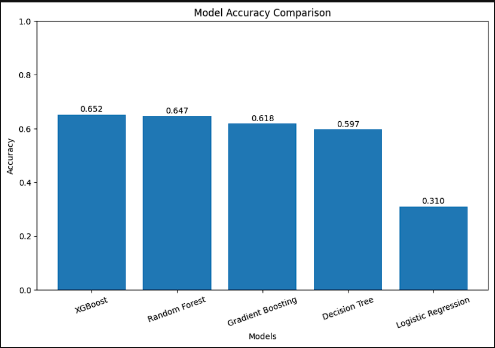

- **Cross-Validation**: 5-Fold Stratified Cross-Validation yielded a mean accuracy of **67.11%** ($\pm 1.19\%$).
- For complete confusion matrices and error analyses, refer to the [Model Performance Guide](docs/MODEL_PERFORMANCE.md).

---

## 📊 Power BI Intelligence Dashboard

The project includes an interactive Microsoft Power BI dashboard (`dashboard/Dashboard.pbix`) that consolidates hiring insights for business stakeholders.

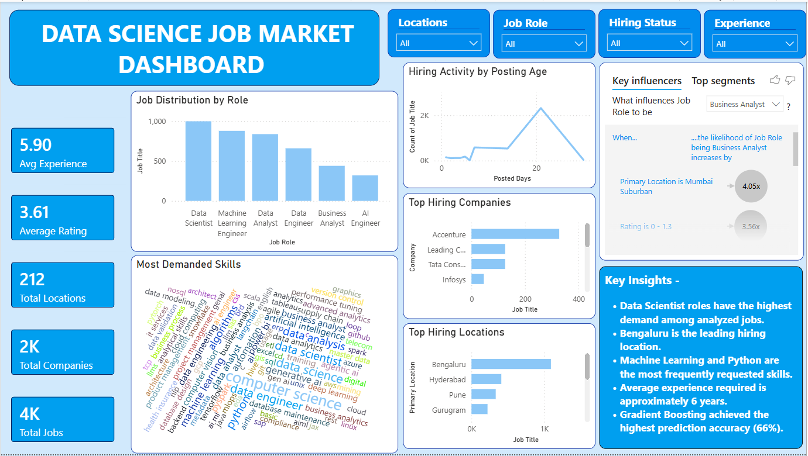

### Power BI AI Visual: Key Influencers
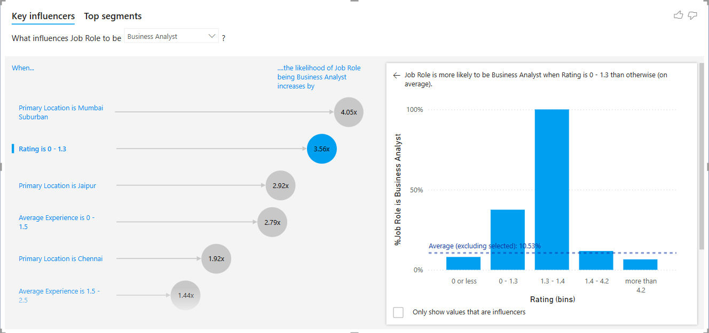

> **Finding**: Power BI's machine-learning Key Influencer visual reveals that job location in **Mumbai Suburban** increases the likelihood of a role being classified as a **Business Analyst by 4.05x**, driven by the high concentration of BFSI corporate headquarters.
> For details on measures, data modeling, and filters, see the [Power BI Guide](docs/POWERBI_DASHBOARD_GUIDE.md).

---

## 💻 CLI Inference Engine & Demo

A production inference script (`src/predict.py`) allows anyone to pass candidate profiles and receive instantaneous role fit classification and salary range estimation:

```bash
python src/predict.py --skills "python, sql, machine learning, pandas, power bi" --experience 4 --location "Bengaluru"
```

### Sample Output:
```text
=================================================================
      NAUKRI JOB MARKET INTELLIGENCE PREDICTION REPORT      
=================================================================
Candidate Profile:
  * Experience : 4.0 Years
  * Location   : Bengaluru
  * Skills     : python, sql, machine learning, pandas, power bi
-----------------------------------------------------------------
Predicted Best-Fit Role : DATA SCIENTIST
Role Match Confidences:
  - Data Scientist             :  40.8% | ########
  - Data Analyst               :  36.7% | #######
  - Machine Learning Engineer  :  20.8% | ####
  - Data Engineer              :   0.8% | 
-----------------------------------------------------------------
Estimated Market Salary : 12.8 LPA (~INR 1,280,000 / yr)
Estimated Salary Range  : 10.9 - 14.7 LPA
=================================================================
```

---

## 🚀 Installation & How to Run

### 1. Clone Repository & Setup Virtual Environment
```bash
git clone https://github.com/Sujal0973/Naukri-Job-Market-Analysis-and-Salary-Prediction.git
cd Naukri-Job-Market-Analysis-and-Salary-Prediction

# Create and activate virtual environment
python -m venv venv
# Windows:
venv\Scripts\activate
# Mac/Linux:
source venv/bin/activate
```

### 2. Install Dependencies
```bash
pip install -r requirements.txt
```

### 3. Run Preprocessing Pipeline
```bash
python src/data_preprocessing.py
```

### 4. Train Models & Export Artifacts
```bash
# Train Job Role Classifier (XGBoost)
python src/train_role_classifier.py

# Train Salary Predictor Regressor
python src/train_salary_predictor.py
```

### 5. Run Live Inference
```bash
python src/predict.py --skills "spark, python, sql, aws, airflow" --experience 5 --location "Pune"
```

---

## 📌 Key Strategic Takeaways

1. **The Core Skill Foundation**: Candidates proficient in `Python` and `SQL` qualify for over 70% of openings across data science, analytics, and data engineering.
2. **Geographic Concentration**: Over 50% of all data opportunities in India are concentrated across **Bengaluru**, **Hyderabad**, and **Pune**.
3. **Mid-Level Demand**: Mid-career professionals (3 to 8 years experience) represent the sweet spot of employer hiring volume.
4. **Compensation Correlation**: Disclosed salary data reveals experience and role specialization (Data Engineering & ML Engineering) command a 25–40% premium over generalist analytics roles.

---

## 🎥 Walkthrough Videos

Comprehensive walkthrough videos covering the end-to-end data pipeline, model training, and Power BI dashboard:

- 📺 **Full Project Overview & Workflow Walkthrough**: [Watch Video Demo](#) *(Add link here)*
- 📊 **Power BI Dashboard Deep Dive & DAX Walkthrough**: [Watch Dashboard Demo](#) *(Add link here)*
- 🤖 **Machine Learning Pipeline & Evaluation**: [Watch ML Walkthrough](#) *(Add link here)*

---

## 👨‍💻 Author

**Sujal Agrahari**  
*Artificial Intelligence & Machine Learning Undergraduate*  
*Dr. Ambedkar Institute of Technology, Bengaluru*  

- 🔗 **GitHub**: [@Sujal0973](https://github.com/Sujal0973)

---

## 🎓 Acknowledgement

This capstone project was developed as part of the **Internshala Data Science Training Program**, showcasing an end-to-end workflow from automated web scraping to machine learning deployment and business intelligence.

---

## ⭐ Support

If you found this project insightful or useful for your own work, consider giving this repository a **⭐ Star**!