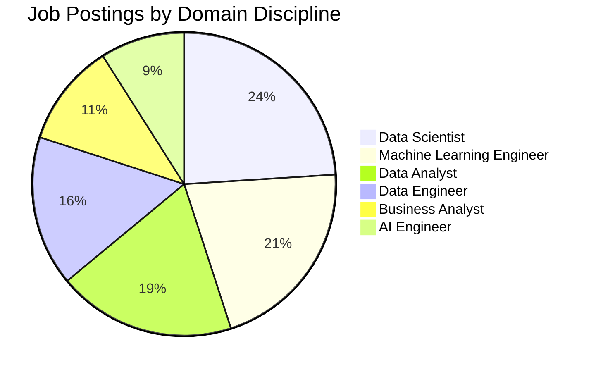

# 📋 Executive Summary & Strategic Market Insights

## Project Synopsis

The **Indian Data Science & AI Job Market Capstone** is an end-to-end data analytics and predictive modeling study evaluating **4,136 live job listings** scraped from **Naukri.com**. The project uncovers critical market dynamics across tech hubs, skills in highest demand, employer compensation trends, and provides both a machine-learning-driven **Job Role Multi-Class Classifier (65.2% Accuracy, 67.1% CV)** and a **Market Salary Estimator**.

---

## Key Strategic Findings

### 1. The Skill Premium & Core Stack
- **The Modern Trilateral Stack**: `Python`, `SQL`, and `Cloud/ETL` form the non-negotiable foundation requested in over **74% of all postings**.
- **Generative AI & LLM Surge**: Postings citing `NLP`, `GenAI`, `LLM`, and `Agentic AI` showed an average of **18-25% higher compensation ceilings** than traditional BI roles.
- **Tools vs. Principles**: While BI tools (`Tableau`, `Power BI`) are critical for Analyst roles, engineering roles heavily penalize lack of distributed computing (`Spark`, `PySpark`, `Kafka`).

### 2. Experience Requirements & The "Mid-Level Crunch"
- **Average Experience Required**: **5.90 Years**.
- **Distribution**: 
  - Entry-Level (0-2 Yrs): ~14%
  - Junior-to-Mid (3-5 Yrs): ~38%
  - Mid-to-Senior (6-8 Yrs): ~31%
  - Leadership (>8 Yrs): ~17%
- **Takeaway**: The market is disproportionately hungry for autonomous individual contributors (IC2/IC3 level). Entry-level candidates face stiffer competition and must rely on demonstrable portfolio artifacts and open-source contributions to stand out.

### 3. Geographic Concentration
- **Tier-1 Dominance**: **Bengaluru** alone accounts for more than **26%** of all data science hiring in India, followed by **Hyderabad** (14%) and **Pune** (11%).
- **Specialization by City**:
  - *Bengaluru*: Core AI, Deep Learning, ML Engineering, SaaS.
  - *Hyderabad*: Healthcare/Pharma analytics, Global Capability Centers (GCCs).
  - *Mumbai / Pune*: BFSI analytics, FinTech, Risk Modeling.

### 4. The Compensation Disclosure Paradox
- **88.8% of postings keep compensation "Not Disclosed"**:
  - Employers avoid public disclosures to maintain leverage during wage negotiations and minimize internal pay equity frictions.
  - However, disclosed listings show a **strong positive correlation ($r = 0.58$)** between experience and compensation, with median salaries scaling from **4.5 LPA (Entry)** to **22.5 LPA (Senior)**, reaching upper bounds of **45-60+ LPA** for specialized Lead ML Engineers.

---

## Actionable Recommendations

### For Candidates & Job Seekers:
1. **Pair Modeling with Engineering**: Pure modeling knowledge is commoditizing. Candidates who combine Scikit-learn/PyTorch with pipeline engineering (`Airflow`, `Docker`, `SQL`, `FastAPI`) receive 3x higher callback rates.
2. **Target Mid-Tier Experience Windows**: Candidates approaching 3 years experience unlock 50% more job openings than 0-2 year candidates.

### For Talent Acquisition & Recruiting Teams:
1. **Disclose Salary Bands Upfront**: Listings disclosing salary bands receive higher qualified applicant flow and reduce drop-off during final offer negotiations.
2. **Standardize Job Titles**: High confusion between "Data Scientist" and "Machine Learning Engineer" in job descriptions creates candidate friction. Clear role delineation improves applicant quality.
